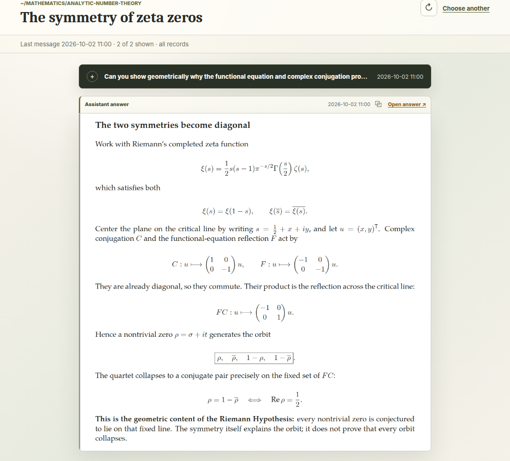

# Conversation viewer and LaTeX

[Back to README](../README.md)

**Read live agent responses with clear typesetting**, or return to older
conversations in a searchable local browser viewer.

```bash
ct viewer                 # choose a conversation
ct viewer launcher        # keyboard-first chooser
codex-viewer status
codex-viewer stop
```

## Launcher and navigation

**Type to filter, use Up/Down, then Enter to open.** The launcher starts the
viewer when needed; `--query TEXT` supplies an initial filter. Local and cached
remote conversations remain selectable offline. A relay view starts with its
own peer; **All sources** broadens the chooser.

| Key | Action |
|---|---|
| T | Switch Markdown/LaTeX |
| L | Jump to the last message, including a user message |
| Shift-L | Open a chooser in a new tab, keeping the reading mode |
| Left/Right | Previous/next message boundary, at most one viewport |
| Hold Shift, then 1–9 | Open a visible footer attachment or link |

## Reading and updates

**S toggles Auto sync.** Manual shows a badge for new messages; R refreshes
without moving your reading position, and Shift-R refreshes and follows the
last message. Background checks stay still. See [sync behavior](viewer-sync.md).

Attachments and external links appear below assistant answers in both modes.
Relative attachment paths use the conversation's recorded working directory.



Rendered by the real viewer from the [Riemann example](examples/riemann-symmetry.jsonl).

## Optional LaTeX view

**Typeset equations, tables, prose, and highlighted code as PDFs.** On the
rendering machine:

```bash
sudo apt install texlive-xetex texlive-latex-extra fonts-texgyre fonts-paratype fonts-dejavu-core
ct viewer doctor
ct viewer --set-default-latex
```

**Markdown works without LaTeX.** Local conversations render locally. For relay
conversations, `auto` uses local XeLaTeX if available, otherwise the peer:

```bash
ct config set viewer.typeset_backend remote
ct viewer restart
```

Other choices are `auto` and `local`; override one launch with
`--typeset-backend remote` or one typeset URL with `?backend=remote`.
Update/restart the relay to enable peer rendering. PDFs are cached privately
for offline reuse; uncached failures retain Markdown fallback and footer links.
Only referenced answers and validated options are accepted, not arbitrary TeX.

## Browser selection

**Use the desktop default or choose a browser:**

```bash
ct viewer open --browser firefox
ct config set viewer.browser firefox
ct config unset viewer.browser
```

Known browsers open a new window; otherwise the desktop URL opener is used.
`CODEX_TOOLS_BROWSER` applies when the setting is `default`. `ct viewer doctor`
checks ports, launching, and LaTeX; startup errors point to the private log under
`~/.local/state/codex-tools/viewer/`.

## Conversation sources

`/v/local/SESSION` and `/t/local/SESSION` read local JSONL history.
`/v/relay/HOST/AGENT` and `/t/relay/HOST/AGENT` use the private relay cache.
Remote attachments are fetched on opening, validated against the assistant
record/link index, and cached offline. Browser requests cannot select arbitrary
remote paths; relay PDFs may render locally or on the authenticated peer.
